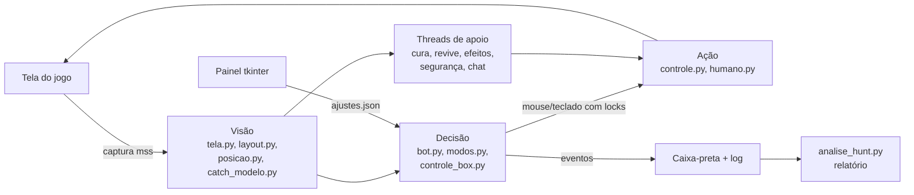

# 🤖 Bot com visão computacional para um jogo 2D

Automação de ponta a ponta que **enxerga a tela, entende o que está acontecendo e decide o que fazer**,
num jogo online 2D (PokeAlliance, cliente OTClient, Windows). Construído do zero em poucas semanas,
**programando junto com IA (Claude Code)**, por alguém que estava aprendendo a programar com o próprio projeto.

> ⚠️ Projeto pessoal de estudo. Usar bots pode ir contra as regras de jogos online. Esta é uma
> **versão de portfólio**: funções de interação com outros jogadores foram retiradas (veja no fim).

---

## O problema

O jogo não tem API. Tudo o que existe é **a imagem da janela**. Para automatizar uma "caçada" (andar por uma
rota, juntar monstros, lutar, curar, capturar os raros) o bot precisa:

- **ver**: achar janelas, barras de vida, criaturas, coordenadas e mensagens do chat só pelos pixels;
- **decidir**: quando lutar, onde ficar para não apanhar, quando reviver o pokémon, quando tacar a pokébola;
- **agir**: mouse e teclado no tempo certo, sem atropelar uma ação com a outra;
- **aprender com os erros**: quando algo dá errado, ter prova do que aconteceu para corrigir.

## O que ele faz

| Área | Como funciona |
|---|---|
| 👁️ **Leitura de tela** | OpenCV + numpy sobre capturas `mss` (~ms por quadro). Âncoras por template matching, barras de vida por cor (HSV), grade do mapa medida sozinha (`layout.py`), mesmo se a janela mudar de tamanho. |
| 🔢 **Coordenadas** | OCR **próprio** de dígitos (modelos em `calibracao/digitos/`), mais rápido e confiável que o Tesseract, que fica só de reserva. |
| 🧭 **Navegação** | Rota gravada por coordenadas + memória do mapa (sqm livres, bloqueados, escadas) + **A\***. Detecta travamento e desvia. |
| ⚔️ **Combate** | Espera o grupo de monstros se formar, posiciona o personagem **na diagonal e longe** (ataques em área), solta o combo e escolhe a estratégia (modos Normal, Revive, Outland, Nightmare). |
| ✨ **Captura de raros** | Detecta o monstro especial pelas estrelinhas e pelo **desenho do corpo** (template matching com máscara, 0,98–1,00 nos raros e ≤ 0,74 no resto, em 33 prints reais) e confirma o resultado da pokébola **lendo o chat**. |
| 💊 **Cura e segurança** | Threads separadas para cura, revive, efeitos negativos e segurança, com locks de mouse/teclado separados. |
| 🖥️ **Painel** | Interface em tkinter com abas, perfis por local ("hunts") e ajustes aplicados **ao vivo** (o bot relê o `ajustes.json` a cada ~2 s). |
| 📦 **Caixa-preta** | Quando o personagem perde vida, salva os quadros de ~3 s antes/depois + um JSON com HP, posição, criaturas e as decisões do bot. É assim que os bugs foram achados. |
| 📊 **Análise de sessão** | `analise_hunt.py` lê o log e gera um relatório: ritmo, tempo de luta, travamentos por coordenada, perigos e capturas. |

## Arquitetura



- **Visão** só lê a tela e devolve números (onde está, quanto de vida, quantos monstros).
- **Decisão** é lógica pura sempre que dá (`controle_box.py`, `navegacao.py`), e por isso dá para testar sem o jogo.
- **Ação** passa por `controle.py`: não clica pausado, não clica fora da janela do jogo, e mouse e teclado têm locks separados.

## Como foi construído: com IA, guiado por evidência

O projeto inteiro foi feito em parceria com o **Claude Code**. O método que funcionou:

1. **Rodar no jogo de verdade** e guardar tudo: log com horário, prints em tamanho real, caixa-preta.
2. **Achar a causa com prova**, não no chute. Exemplos reais:
   - o personagem morria no revive → os quadros da caixa-preta mostraram um monstro **fora** do grupo atacando de
     4 sqm de distância → regra nova: só revive com folga dos monstros soltos;
   - o bot contava 1–2 monstros a mais → o **nome vermelho** do alvo virava uma "linha" a mais na lista
     → leitura presa à grade da lista;
   - a pokébola ia num monstro raro ainda **vivo** → no jogo a barra dele é magenta, e o bot achava que era
     um monstro "não atacável" → barra magenta passou a contar como vivo, com teste usando o print real.
3. **Transformar cada bug em teste** com o print real que mostrou o problema.
4. **Documentar para a IA**: um guia do projeto (mapa dos arquivos, medidas do jogo já conferidas, armadilhas já
   resolvidas) para cada sessão nova começar sabendo o que já foi aprendido, sem repetir erro.

## Testes

**35 arquivos, 413 verificações**, a maioria com **prints reais** do jogo em `testes/dados/`.

```bash
python testes/rodar_testes.py            # todos
python testes/rodar_testes.py catch      # só os que têm "catch" no nome
```

O runner liga um modo de teste (o mouse e o teclado de verdade não se mexem), faz backup dos dados do usuário e
restaura no fim, e mata qualquer teste que passe de 120 s.

## Rodar

Requisitos: Windows, Python 3.14 e [Tesseract OCR](https://github.com/tesseract-ocr/tesseract) (reserva).

```bash
python -m venv venv
venv\Scripts\pip install -r requirements.txt
venv\Scripts\python painel.py
```

## Números

- ~11 mil linhas de Python em 27 módulos, mais ~4,5 mil linhas de testes
- Medidas do jogo conferidas em centenas de prints reais (ex.: detector de player na tela: 0 falsos em 407 prints)
- Leitura de tela no laço principal em milissegundos; o que é lento (OCR, ~200 ms) roda em thread separada

## Stack

Python · OpenCV · numpy · mss · Tesseract/pytesseract · tkinter · pydirectinput · threading · A\* · Claude Code

## O que ficou de fora desta versão

Para publicar, retirei os módulos que interagiam com outros jogadores ou com a equipe do jogo: o assistente com
LLM (Gemini) que respondia mensagens, a ida até outros players e o detector de mensagens da moderação. Chaves de
API, configurações pessoais, logs e rotas também não estão no repositório.
